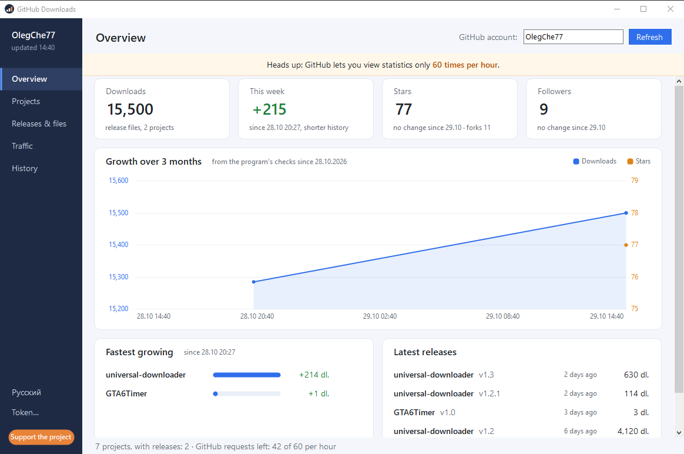
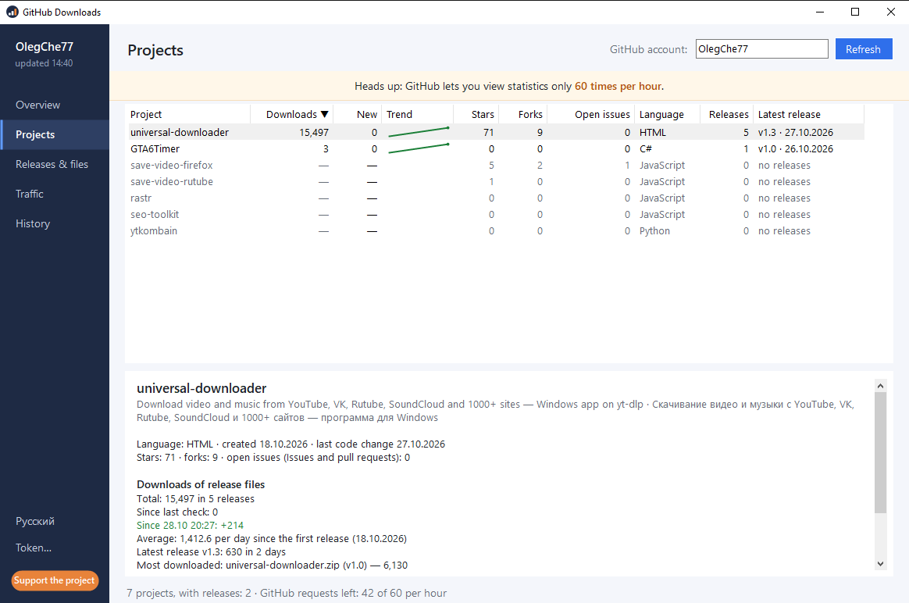
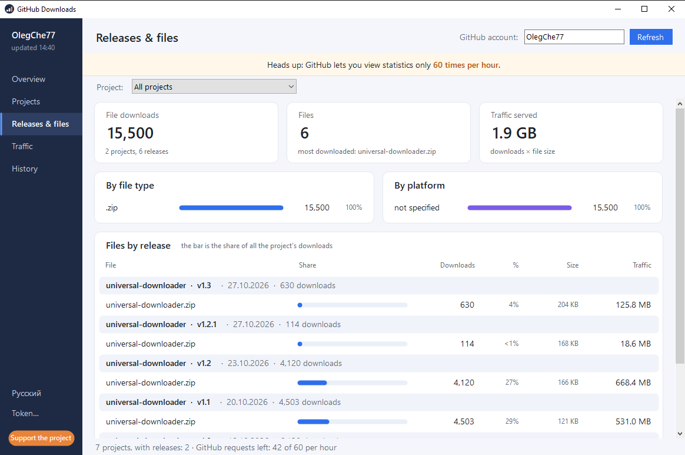
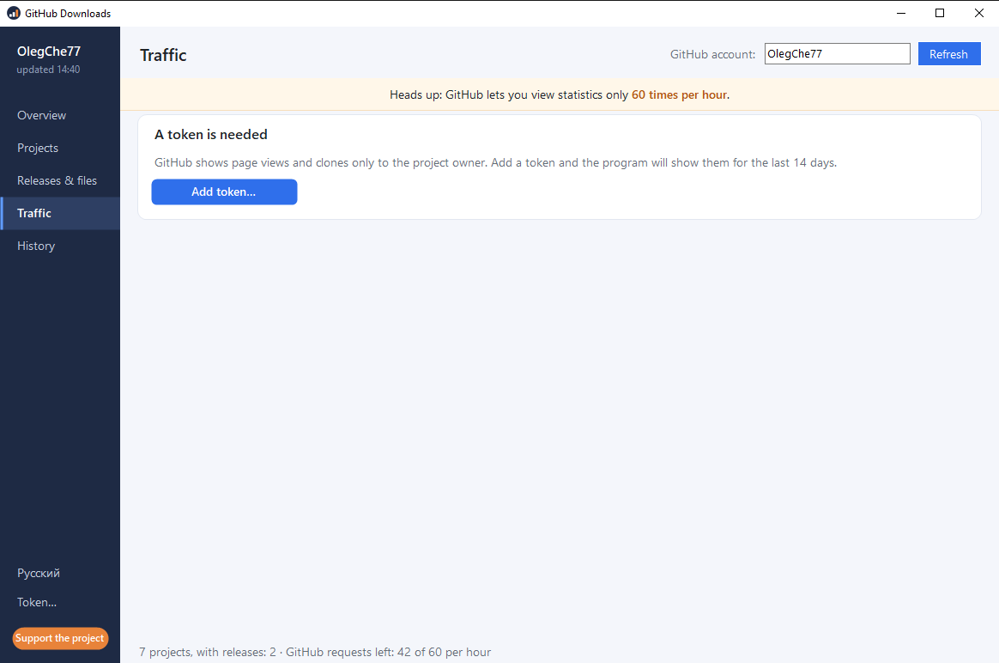
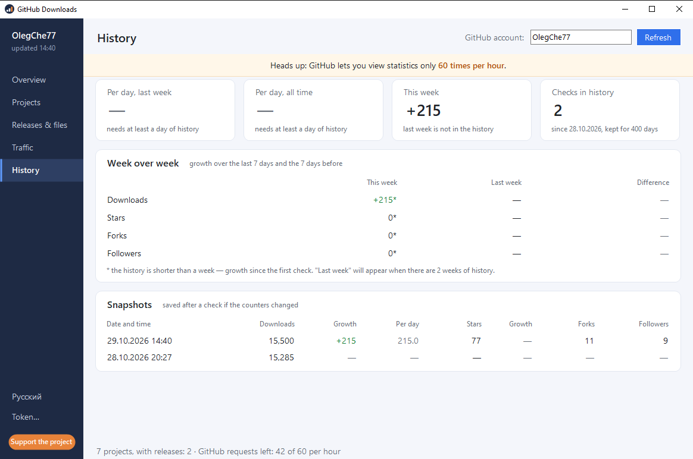

<p align="center">
  <a href="https://dalink.to/olegche"></a>
</p>

# GitHub Downloads

[Русский](README.md) · **English**

[](../../releases/latest)
[](../../releases)
[](#installation)
[](#features)
[](../../stargazers)

A Windows app that shows the statistics of your public GitHub projects: **how many times the files from your releases were downloaded**, growth over the week, stars, forks and followers. GitHub exposes these numbers through its API separately for every file of every release. Here everything is in one window: totals, growth charts and a history of checks.



**[⬇ Download the latest version (zip)](https://github.com/OlegChe77/github-downloads/releases/latest/download/GitHubDownloads.zip)** (`GitHubDownloads.zip`, direct file) · [release page](../../releases/latest)

Nothing to install: the archive holds a single `GhDownloads.exe`. It runs on Windows 10 and 11 with no extra libraries (it uses .NET Framework 4, which is already part of the system).

## Features

- **Downloads** of release files across all your projects: the total, per project, per release and per file.
- **Growth**: “new” since the last check and “this week”. The app keeps its own history of checks (up to 400 days) and draws charts from it.
- **Stars, forks and followers** next to downloads, on the same chart.
- **File types and platforms**: shares of downloads by file type and by platform (the platform is detected from the file name), and a traffic estimate (downloads × size).
- **Views and clones** of your repositories and **referrers**, if you provide a token (see [below](#token-for-traffic)).
- Interface in **Russian and English**, the switch is at the bottom left. On the first start the language follows the system.
- Works with any account: type the username in the field at the top.

|  |  |
|:--|:--|
|  |  |

Switch pages with the buttons on the left or with **Ctrl+1…5**; refresh with **F5**.

## Installation

1. Download **[GitHubDownloads.zip](https://github.com/OlegChe77/github-downloads/releases/latest/download/GitHubDownloads.zip)** (always the latest version; what’s new is on the **[Releases](../../releases/latest)** page).
2. Unpack it to any folder, for example the desktop.
3. Run `GhDownloads.exe`, type your GitHub username and press “Refresh”.

If Windows shows the blue SmartScreen window (“Windows protected your PC”): the app is not digitally signed. Click “More info” → “Run anyway”. The source code is open, so you can read it and build it yourself ([how](#building-from-source)).

To uninstall, just delete the folder. The settings are in the registry under `HKCU\Software\GitHubDownloads` and the history of checks is in `%APPDATA%\GitHubDownloads`; delete them too if you like.

## GitHub limit: 60 checks per hour

Without a token GitHub allows **60 requests per hour** per IP address. One refresh costs 2 requests plus one per project, so with 10 projects you get about five refreshes an hour. This is GitHub’s limit, not the app’s. So don’t press “Refresh” needlessly: the history keeps growing anyway, and when the limit is used up the app shows the time after which you can try again. With a token the limit is 5000 requests per hour.

## Token for traffic

GitHub shows views and clones only to the owner of a repository, so the “Traffic” page needs a token:

1. GitHub → Settings → Developer settings → Personal access tokens → **Fine-grained tokens** → Generate new token.
2. Select your repositories and grant **Administration: Read-only** (nothing else is needed).
3. In the app press “Token…” at the bottom left and paste the token.

The token is stored in the Windows registry encrypted (DPAPI, for your Windows account only) and is sent only to `api.github.com`. Alternatively, set the `GITHUB_TOKEN` environment variable. For projects the token has no access to, traffic is simply not shown.

## What is counted

- Only **files attached to releases** (`Releases → Assets`) are counted. The “Download ZIP” button on a repository’s main page, `git clone` and the automatic `Source code` archives are not part of GitHub’s download counter.
- Forks and draft releases are skipped.
- “Traffic” on the releases page is an estimate: downloads × file size.
- The history of downloads, stars, forks and followers is kept by the app itself, starting from the first check: the earlier you start it, the longer the charts. GitHub returns views and clones only for the last 14 days.

## Building from source

All you need is the C# compiler that ships with Windows (`csc.exe`); no Visual Studio. The whole code is one file, [`src/GhDownloads.cs`](src/GhDownloads.cs) (WinForms, C# 5):

```powershell
& "$env:WINDIR\Microsoft.NET\Framework64\v4.0.30319\csc.exe" /nologo /target:winexe /optimize+ /codepage:65001 /out:GhDownloads.exe /win32icon:src\app.ico /resource:src\app.ico,app.ico /r:System.Windows.Forms.dll /r:System.Drawing.dll /r:System.Web.Extensions.dll /r:System.Security.dll /r:System.Core.dll src\GhDownloads.cs
```

## Support the project

The app is free. If it was useful, you can [support the author](https://dalink.to/olegche): it helps to make new versions and other programs. Bugs and ideas go to [Issues](../../issues).

<p align="center">
  <a href="https://dalink.to/olegche"></a>
</p>
