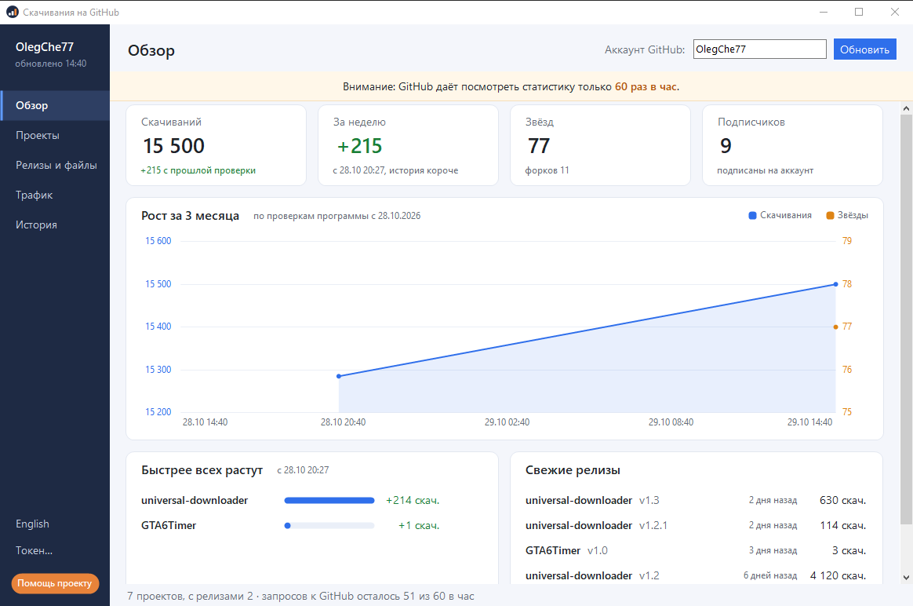
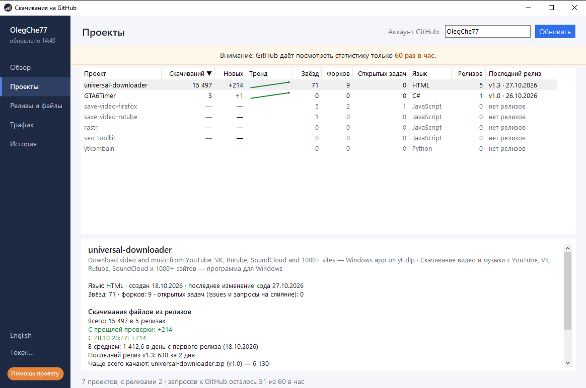
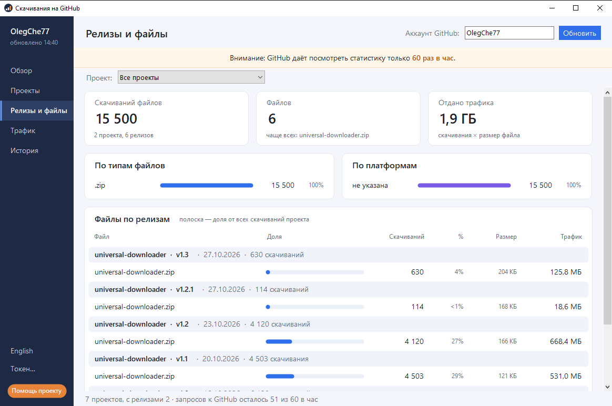
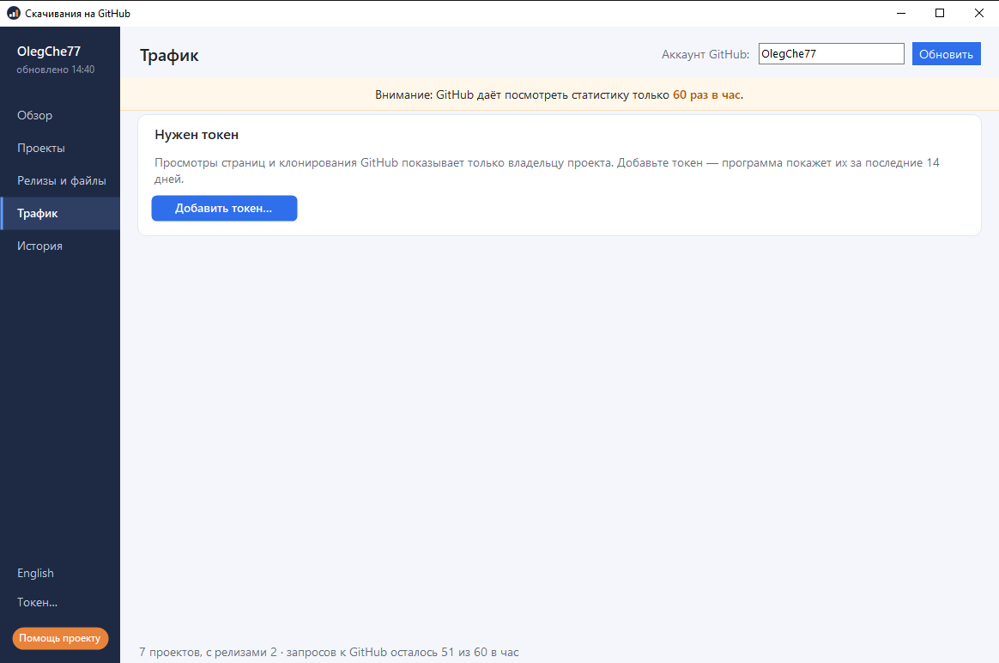
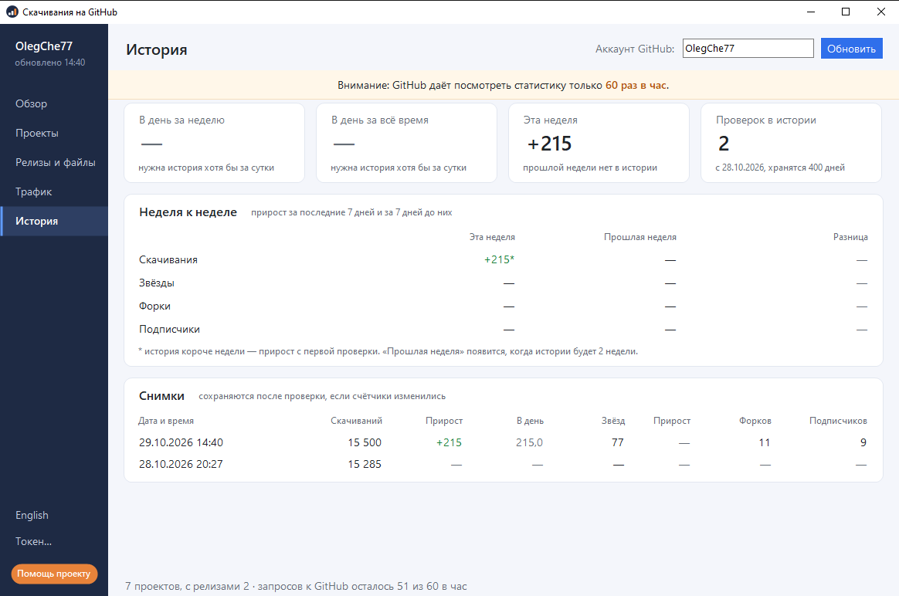

<p align="center">
  <a href="https://dalink.to/olegche"></a>
</p>

# Скачивания на GitHub

**Русский** · [English](README.en.md)

[](../../releases/latest)
[](../../releases)
[](#установка)
[](#возможности)
[](../../stargazers)

Программа для Windows, которая показывает статистику ваших публичных проектов на GitHub: **сколько раз скачали файлы из релизов**, прирост за неделю, звёзды, форки и подписчики. GitHub отдаёт эти числа через API отдельно по каждому файлу каждого релиза. Здесь всё собрано в одно окно: итоги, графики роста и история проверок.



**[⬇ Скачать последнюю версию (zip)](https://github.com/OlegChe77/github-downloads/releases/latest/download/GitHubDownloads.zip)** (`GitHubDownloads.zip`, прямая ссылка на файл) · [страница релиза](../../releases/latest)

Ставить ничего не нужно: внутри один файл `GhDownloads.exe`. Работает на Windows 10 и 11, дополнительные библиотеки не нужны (используется .NET Framework 4, он уже есть в системе).

## Возможности

- **Скачивания** файлов релизов по всем вашим проектам: всего, по каждому проекту, по каждому релизу и файлу.
- **Прирост**: «новых» с прошлой проверки и «за неделю». Программа сама хранит историю проверок (до 400 дней) и рисует графики.
- **Звёзды, форки, подписчики** — рядом со скачиваниями, на одном графике.
- **Типы файлов и платформы**: доли скачиваний по типам файлов и по платформам (платформа определяется по имени файла), и оценка трафика (скачивания × размер).
- **Просмотры и клонирования** репозиториев, **источники переходов** — если указать токен (см. [ниже](#токен-для-трафика)).
- Интерфейс на **русском и английском**, переключатель слева внизу. Первый запуск — язык по системе.
- Работает с любым аккаунтом: введите имя пользователя в поле сверху.

|  |  |
|:--|:--|
|  |  |

Разделы переключаются кнопками слева и сочетаниями **Ctrl+1…5**, обновление — **F5**.

## Установка

1. Скачайте **[GitHubDownloads.zip](https://github.com/OlegChe77/github-downloads/releases/latest/download/GitHubDownloads.zip)** (всегда последняя версия; что нового — на странице **[Releases](../../releases/latest)**).
2. Распакуйте в любую папку, например на рабочий стол.
3. Запустите `GhDownloads.exe`, введите имя аккаунта GitHub и нажмите «Обновить».

Если Windows показала синее окно SmartScreen («Windows защитила ваш компьютер»): программа не подписана цифровой подписью. Нажмите «Подробнее» → «Выполнить в любом случае». Исходный код открыт, его можно прочитать и собрать самому ([как](#сборка-из-исходников)).

Удаление: просто удалите папку с программой. Настройки лежат в реестре `HKCU\Software\GitHubDownloads`, история проверок — в `%APPDATA%\GitHubDownloads`; при желании удалите и их.

## Лимит GitHub: 60 проверок в час

Без токена GitHub разрешает **60 запросов в час** с одного IP-адреса. Одно обновление тратит 2 запроса плюс по одному на каждый ваш проект, поэтому при 10 проектах хватит примерно на пять обновлений в час. Это ограничение GitHub, а не программы. Поэтому не нажимайте «Обновить» без нужды: история копится и без этого, а когда лимит исчерпан, программа показывает время, после которого можно повторить. С токеном лимит 5000 запросов в час.

## Токен для трафика

Просмотры и клонирования GitHub показывает только владельцу репозитория, поэтому раздел «Трафик» работает с токеном:

1. GitHub → Settings → Developer settings → Personal access tokens → **Fine-grained tokens** → Generate new token.
2. Выберите свои репозитории и дайте право **Administration: Read-only** (больше ничего не нужно).
3. В программе нажмите «Токен…» слева внизу и вставьте токен.

Токен хранится в реестре Windows в зашифрованном виде (DPAPI, только для вашей учётной записи Windows) и отправляется только на `api.github.com`. Вместо этого можно задать переменную окружения `GITHUB_TOKEN`. Для проектов, к которым у токена нет доступа, трафик просто не показывается.

## Что считается

- Считаются **только файлы, прикреплённые к релизам** (`Releases → Assets`). Кнопка «Download ZIP» на главной странице репозитория, `git clone` и автоматические архивы исходников (`Source code`) в счётчик скачиваний GitHub не входят.
- Форки и черновики релизов пропускаются.
- «Трафик» в разделе релизов — это оценка: число скачиваний × размер файла.
- Историю скачиваний, звёзд, форков и подписчиков программа ведёт сама, начиная с первой проверки: чем раньше вы её запустили, тем длиннее графики. Просмотры и клонирования GitHub отдаёт только за последние 14 дней.

## Сборка из исходников

Нужен только компилятор C# из состава Windows (`csc.exe`), ставить Visual Studio не нужно. Весь код — один файл [`src/GhDownloads.cs`](src/GhDownloads.cs) (WinForms, C# 5):

```powershell
& "$env:WINDIR\Microsoft.NET\Framework64\v4.0.30319\csc.exe" /nologo /target:winexe /optimize+ /codepage:65001 /out:GhDownloads.exe /win32icon:src\app.ico /resource:src\app.ico,app.ico /r:System.Windows.Forms.dll /r:System.Drawing.dll /r:System.Web.Extensions.dll /r:System.Security.dll /r:System.Core.dll src\GhDownloads.cs
```

## Помощь проекту

Программа бесплатная. Если она пригодилась, можно [поддержать автора](https://dalink.to/olegche): это помогает делать новые версии и другие программы. Ошибки и пожелания — в [Issues](../../issues).

<p align="center">
  <a href="https://dalink.to/olegche"></a>
</p>
